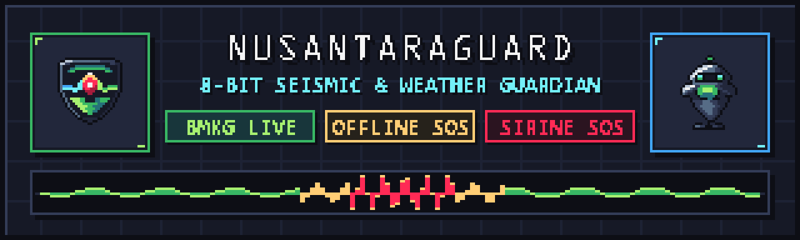
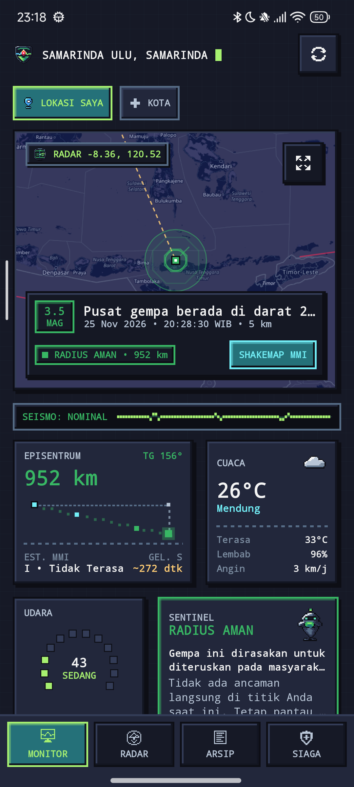
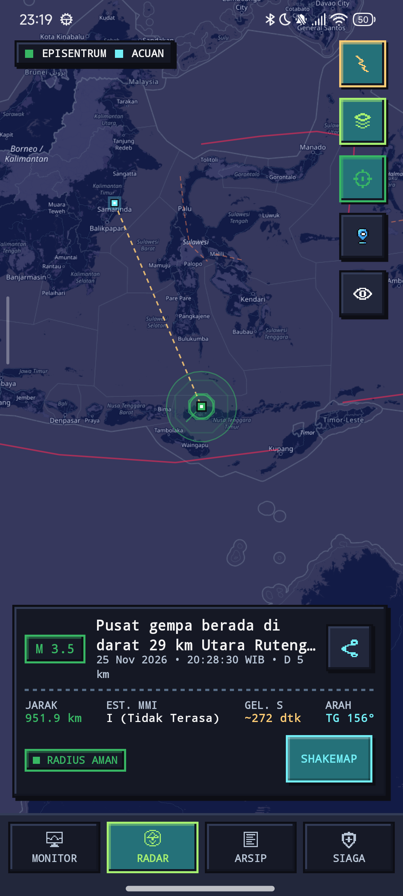
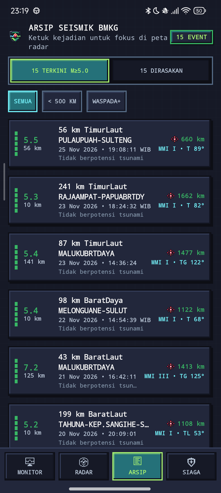
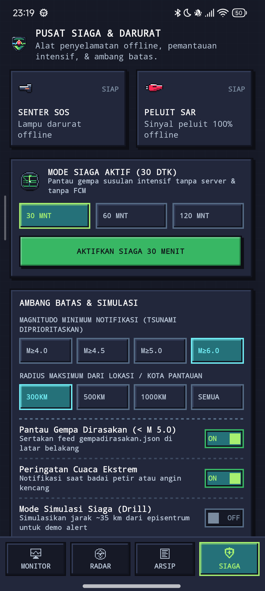

 
 

# NusantaraGuard

**Aplikasi Peringatan Dini Gempa Bumi BMKG, Cuaca Ekstrem & Alat Siaga Darurat Offline bergaya Pixel Art 8-Bit untuk Indonesia**

-38B764?style=for-the-badge&logo=android&logoColor=white)

---

## Apa Itu NusantaraGuard?

**NusantaraGuard** adalah aplikasi pendamping kesiapsiagaan bencana di Android yang dirancang khusus untuk wilayah rawan gempa dan cuaca ekstrem di Nusantara. Aplikasi ini mengambil data gempa resmi langsung dari **BMKG**, menggabungkannya dengan kondisi **cuaca & kualitas udara (AQI)** di lokasi Anda serta kota-kota tempat keluarga tinggal, lalu menyajikannya dalam antarmuka retro **Tactical Midnight 8-Bit** yang jelas dibaca saat kondisi normal maupun darurat.

Berbeda dengan aplikasi notifikasi biasa, NusantaraGuard bekerja **langsung dari perangkat tanpa perantara server pihak ketiga**, tetap bisa menampilkan data cache terakhir saat sinyal terputus, membunyikan **sirine darurat lewat saluran alarm ponsel (`USAGE_ALARM`)** saat ancaman kritis terdeteksi, dan menyediakan **alat penyelamatan offline** (Senter SOS Morse & Peluit SAR).

---

## Fitur Utama

### 1. Monitor Seismik Real-Time & Analisis Risiko Lokal
* **Feed Resmi BMKG Lengkap:** Memantau gempa terbaru (*AutoGempa*), daftar gempa M ≥ 5.0 (*Gempaterkini*), dan gempa kecil yang dirasakan warga (*Gempa Dirasakan*).
* **Kalkulasi Jarak Haversine & Kedalaman 3D:** Menghitung jarak akurat dari posisi Anda ke titik episentrum sekaligus memperkirakan skala intensitas **MMI lokal**.
* **Estimasi Waktu Gelombang P & S:** Memberi gambaran perkiraan jeda tiba gelombang getaran primer (`P-Wave`) dan sekunder (`S-Wave`) serta arah kompas episentrum.
* **Peta Guncangan (Shakemap MMI):** Menampilkan visual peta intensitas guncangan resmi BMKG untuk kejadian gempa utama.

### 2. Peta Radar 8-Bit & Garis Patahan Aktif Indonesia
* **Peta Taktis Bergaya Retro:** Peta interaktif berwarna gelap agar jalur patahan, cincin radius guncangan (`50 km` & `150 km`), dan animasi gelombang kejut episentrum terlihat kontras.
* **Overlay Patahan Nusantara:** Menampilkan jalur zona subduksi dan sesar aktif Indonesia langsung di atas peta radar.
* **Fokus Cepat:** Pindah fokus kamera sekali ketuk antara **Episentrum Gempa**, **Lokasi Acuan**, atau **Keduanya Sekaligus**, serta tombol **Bagikan Info Gempa** ke keluarga.

### 3. Sirine Darurat Jelas & Pantauan Multi-Kota Keluarga
* **Sirine Darurat Saluran Alarm:** Untuk gempa berdampak **Kritis**, potensi **Tsunami**, maupun uji **Simulasi Siaga**, aplikasi membunyikan sirine dual-tone harmonik pada stream alarm sistem disertai pola getar SOS agar tetap terdengar jelas meskipun volume notifikasi biasa sedang kecil.
* **Kontrol Cepat Sirine:** Tombol **"Matikan Sirine"** tersedia langsung pada notifikasi, atau berhenti otomatis ketika notifikasi digeser/dibuka.
* **Pantauan Kota Keluarga (*Watchlist*):** Tambahkan kota tempat tinggal orang tua atau keluarga untuk melihat jarak episentrum gempa terbaru dan kondisi cuaca di kota tersebut.
* **Notifikasi Ikon 8-Bit & Home Screen Widget:** Widget layar utama menampilkan ringkasan magnitudo, jarak gempa, lokasi, dan cuaca lokal secara cepat.

### 4. Cuaca, Kualitas Udara (AQI) & Pusat Siaga Offline
* **Telemetri Atmosfer Lengkap:** Suhu saat ini, suhu terasa (*apparent*), kelembaban, angin, indeks UV, PM2.5, tingkat polusi **European AQI**, grafik tren per jam (**24 Jam**), serta prakiraan **7 Hari**.
* **Toolkit Penyelamatan 100% Offline:**
  * **Senter SOS Morse:** Memancarkan sinyal cahaya kedip pola Morse internasional (`••• --- •••`) memakai flash kamera.
  * **Peluit SAR:** Menghasilkan suara peluit frekuensi tinggi (`~3 kHz`) tanpa internet untuk membantu tim penyelamat menemukan lokasi.
  * **Mode Siaga Aktif (30 Detik):** Pemantauan gempa susulan intensif setiap 30 detik (pilihan durasi 30, 60, atau 120 menit) lengkap dengan timer hitung mundur.
  * **Checklist Tas Siaga Bencana:** Daftar periksa perlengkapan darurat 72 jam beserta indikator kelengkapan.
* **Mode Simulasi Siaga (Drill):** Menguji tampilan darurat aplikasi, suara sirine, dan notifikasi seolah-olah gempa berjarak `~35 km` dari lokasi Anda.

---

## Animasi & Karakter Pixel Art 8-Bit

Seluruh maskot, status cuaca, dan peralatan darurat digambar khusus secara *frame-by-frame* di **Aseprite** agar aplikasi terasa hidup tanpa mengganggu keterbacaan informasi penting:

| Guardian Aman | Guardian Waspada | Guardian Darurat | Radar Sapuan |
| :---: | :---: | :---: | :---: |
|  |  |  |  |
| *Status Radius Aman* | *Status Waspada* | *Bahaya Kritis / Tsunami* | *Radar Episentrum Aktif* |

| Cuaca Cerah | Badai Petir | Senter SOS Morse | Peluit SAR 3 kHz |
| :---: | :---: | :---: | :---: |
|  |  |  |  |
| *Kondisi Cerah* | *Peringatan Badai* | *Sinyal Darurat Kamera* | *Audio Penyelamat Offline* |

---

<!-- SCREENSHOTS_START -->
## Tampilan Aplikasi Asli (Android)

| Layar Monitor Utama | Peta Radar Penuh | Arsip Seismik BMKG | Pusat Siaga & Darurat |
| :---: | :---: | :---: | :---: |
|  |  |  |  |
| *Lokasi aktif, mini-peta radar, osiloskop seismograf, cuaca, AQI & Guardian Sentinel* | *Peta taktis 8-bit, garis patahan aktif & cincin radius guncangan* | *Riwayat 15 gempa terkini M>=5.0 & 15 gempa dirasakan lengkap dengan filter jarak* | *Senter SOS Morse, Peluit SAR 3 kHz, Mode Siaga 30 detik & Checklist Tas Siaga* |

<!-- SCREENSHOTS_END -->

---

## Sumber Data & Catatan Keselamatan

* **Data Gempa & Shakemap:** Badan Meteorologi, Klimatologi, dan Geofisika (**[BMKG](https://data.bmkg.go.id/)**)
* **Data Cuaca & Kualitas Udara:** **[Open-Meteo](https://open-meteo.com/)**
* **Peta Dasar & Pencarian Wilayah:** **[OpenStreetMap](https://www.openstreetmap.org/)** & **Nominatim**

> **Catatan:** NusantaraGuard berfungsi sebagai alat bantu kewaspadaan cepat berbasis pemantauan data publik resmi. Dalam situasi bencana nyata, selalu utamakan keselamatan jiwa serta patuhi arahan evakuasi resmi dari **BMKG**, **BNPB**, dan pihak berwenang setempat.
